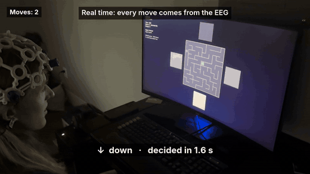
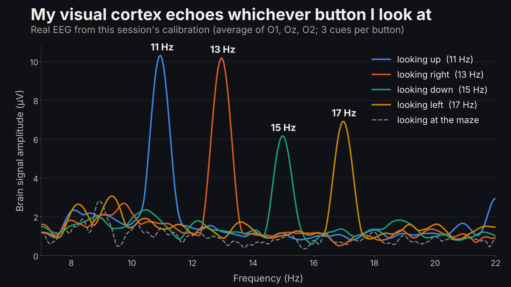
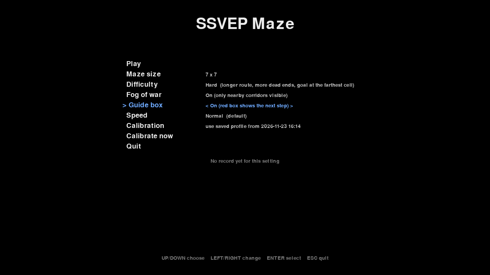
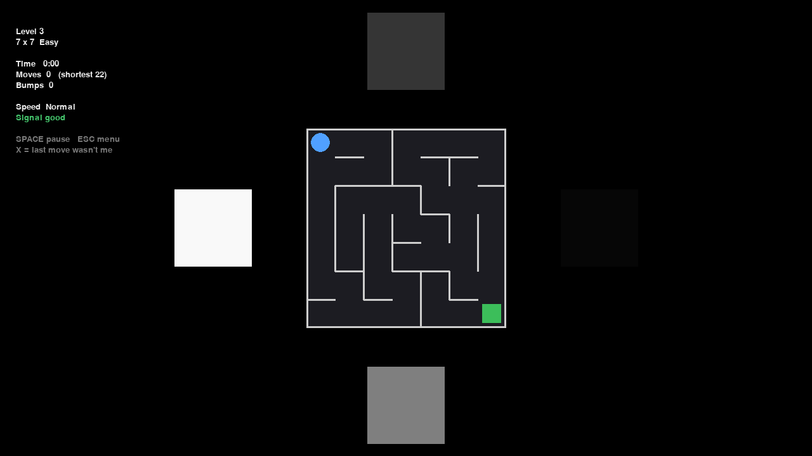

# SSVEP Maze

A maze game you play with your eyes and an EEG headset, no hands or keyboard.



**Short demo (52 s):**

https://github.com/user-attachments/assets/49713f55-b49b-4ccd-8c1c-eb72a67daeeb

**Full walkthrough (5 min):** [watch on YouTube](https://youtu.be/OEm6jOV22Ak?si=iLtVafPRquwm8RIr). It covers the headset, how SSVEP works, calibration, an uncut maze run, and results.

There are four buttons around the maze and each one flickers at a different rate (11, 13, 15 and 17 Hz).
When you look at one of them, your visual cortex starts firing at that same rate, which is called an
SSVEP (steady-state visually evoked potential). I have three dry electrodes on the back of my head
that pick that up, the code figures out which frequency is strongest, and the dot moves that way. If
you're just looking at the maze to plan your route, nothing should happen.

> **Warning:** this uses flickering lights, which can trigger seizures in people with photosensitive
> epilepsy. Please don't use it if that applies to you or whoever is wearing the headset.

## How well it works

These are all my own sessions over three days, so it's one person and not a study, but here's where
it ended up:

| | |
|---|---|
| Guided moves correct (following the red box) | **284 / 284** across 3 sessions |
| Time per move (median) | **1.5 to 1.65 s** on Turbo, 1.8 to 1.9 s on Normal |
| Information transfer rate (guided) | **72 bits/min** on Turbo, 66 on Normal |
| Unintended moves in free play | **3** out of 505 (2 I flagged with the X key, 1 wall bump) |
| Hardware | OpenBCI Ganglion, 3 dry electrodes (O1, Oz, O2), 3D-printed Ultracortex |

The first version that actually worked got 217/222 decisions right (97.7%) but took about 2.8 s per
move, which was slower than I wanted. To speed it up I recorded my sessions and replayed them offline
through about 2,700 different decision rules to see which ones were faster without losing accuracy.
On the same recorded data the rule I ended up with is about 20% faster. The rest of the speedup came
from better electrode contact on later days and the Turbo setting. The full numbers and the caveats
are in [docs/results.md](docs/results.md).



## How it works

The short version:

1. The buttons' brightness follows a sine wave that's tied to the monitor's frame count, so each one
   flickers at exactly its frequency (I use a 120 Hz monitor with vsync on).
2. The EEG from O1, Oz and O2 comes in at 200 samples a second and gets filtered to 6 to 45 Hz, plus a
   60 Hz notch for the hum from the power lines.
3. Ten times a second, CCA (canonical correlation analysis) checks how strongly each button's
   frequency and its harmonics show up in the last 1 to 1.25 s of signal.
4. A calibration at the start (about 70 s) measures what each button's score looks like when you're
   looking at it and when you're not, so all four buttons can be compared on the same 0 to 1 scale.
5. The scores add up over the last 3 s, and the dot moves once one button is clearly ahead of the
   others and its average is high enough. Right after a move it ignores the next second or so while
   your eyes get to the next button.

If you want the longer explanation and why I made each choice, it's in
[docs/how_it_works.md](docs/how_it_works.md).

## The game

 

*The menu and a maze in play. These screenshots are from the simulated headset, and each button is
caught at a different point in its flicker.*

You can pick maze sizes from 5×5 up to 13×13, three difficulties, and fog of war if you want it
harder. There's an optional red guide box that shows the best move, which is also how I measure
accuracy. There are four speed settings (Careful, Normal, Fast and Turbo), and after calibrating it
recommends one based on how clean your signal was. It also tracks stars and personal bests, and it
records everything from every session so you can go back and analyze it.

## Running it

You need Python 3.10 or newer.

```bash
pip install -r requirements.txt

python maze_game.py --board sim --windowed     # try it with a simulated headset
python maze_game.py                            # with an OpenBCI Ganglion on the BLED112 dongle
```

Make sure the OpenBCI GUI is closed first, since only one program can connect to the board at a time.
`python maze_game.py --help` shows all the options.

In the menu use the arrow keys and Enter, and Esc quits. During a maze, Space pauses, Esc opens the
pause menu, and X marks the last move as one you didn't mean (it gets logged so I can count false
moves).

Setting up the headset, where the electrodes go, and connection problems are covered in
[docs/hardware.md](docs/hardware.md).

## What's in here

```
maze_game.py              start the game
ssvep_maze/               the game, one job per file
    settings.py           every number you might want to tweak, with an explanation
    headset.py            Ganglion connection, recording, simulated headset
    signal_processing.py  filtering and CCA scoring
    decision.py           calibration levels and the rule that decides when to move
    maze.py               maze generation and pathfinding
    screen.py             drawing
    calibration.py        the calibration routine
    level.py              playing one maze
    game.py               menus, the frame loop, saving
tools/                    my earlier flicker experiments, analysis, and a session replay tool
tests/                    automated tests (python -m pytest)
docs/                     how it works, hardware, results, data format
```

## Testing

```bash
python -m pytest                                         # signal processing, decision rule, mazes
python tools/replay_session.py data/sub-S01/game-<time>  # re-run a recorded session through the decision code
```

The replay tool runs the raw EEG from a session back through the decision code and gets the same
moves I made live (292/292 and 206/206 on two sessions). That's how I tested changes to the decision
rule before putting the headset back on.

## Thanks

- [OpenBCI](https://openbci.com) for the Ganglion and the
  [Ultracortex Mark IV](https://github.com/OpenBCI/Ultracortex) headset design (I printed it, the files
  aren't copied here)
- [BrainFlow](https://brainflow.org) for the board interface
- Synaptech at UW for lending me the Ganglion
- I wrote the code for the maze with assistance from Claude

## License

MIT, see [LICENSE](LICENSE).
