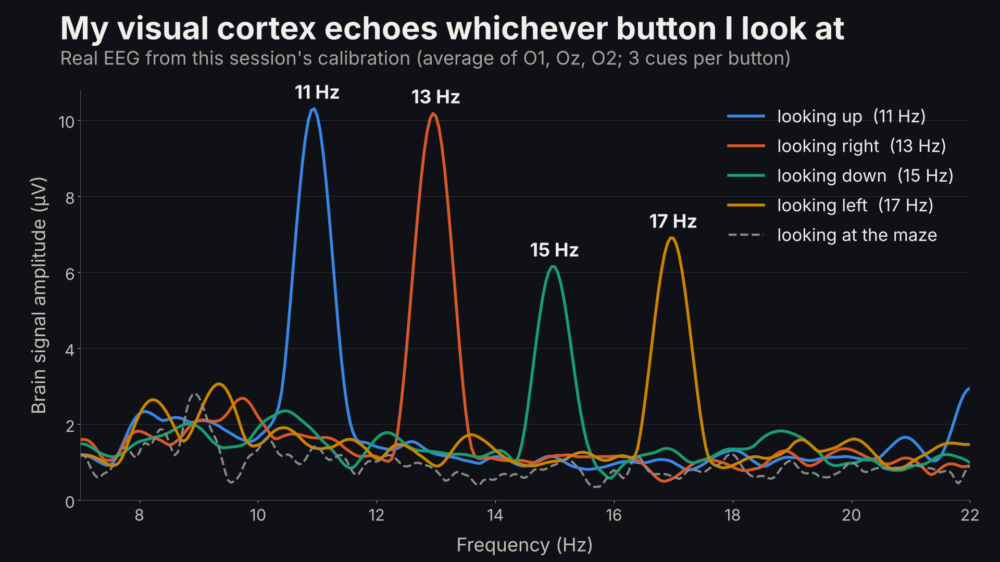
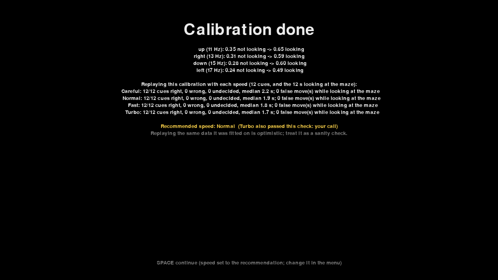

# How it works

## The signal (SSVEP)

When you look at a light that flickers at a steady rate, the neurons in your visual cortex (at the
back of your head) start firing in step with it. So the EEG over that area picks up a small
oscillation at the flicker frequency, plus its harmonics (2f, 3f and so on). That's called a
steady-state visually evoked potential, or SSVEP. It's strongest for whatever you're looking straight
at and a lot weaker for things in the edge of your vision, which is the whole reason this works.

In my four-target test, the power at the frequency I was looking at was 4 to 6 times the background.
This spectrum is from one of my game calibrations, one panel per button:

## Picking the frequencies

The buttons flicker at 11, 13, 15 and 17 Hz. In an early test I used 9 Hz and it kept getting confused
with alpha, the 8 to 12 Hz rhythm your brain makes when you're relaxed, so I moved everything above
that. They're 2 Hz apart so a short window can still tell neighbors apart, and they're low enough that
the 2nd harmonics stay under 45 Hz (where the filter cuts off) and well under the Ganglion's 100 Hz
limit.

The brightness follows a sine wave based on the frame number instead of the clock. With vsync on a
120 Hz monitor, that makes each button's frequency exact, even when it doesn't divide evenly into the
refresh rate. I used a sine wave instead of just flashing on and off because it puts the response at
the main frequency instead of spreading it across a bunch of harmonics.

## Filtering

The EEG comes in at 200 samples a second from O1, Oz and O2 (the standard 10-20 positions over the
visual cortex). It gets filtered using only past samples, the same way it has to work live, with a
4th-order Butterworth band-pass from 6 to 45 Hz (which gets rid of slow drift, electrode movement and
most muscle noise) and a 60 Hz notch for power line hum.

If any channel swings more than 300 µV in a window, that window gets skipped, because that's a blink,
movement or an electrode losing contact and not anything from the brain.

## Scoring with CCA

For each button the code makes reference signals, which are sine and cosine waves at the button's
frequency and the next two harmonics. Then it computes the canonical correlation between those and the
latest window of EEG. Basically that finds the best possible correlation between any weighted mix of
my three channels and any weighted mix of the reference waves. Using both sine and cosine means the
phase of the response doesn't matter, and the channel weights adjust on their own to wherever the
signal is strongest.

This runs 10 times a second on a sliding window that's 1.0 s long on Turbo and 1.25 s on the other
speeds. I also tried extended CCA (which uses calibration templates), filter-bank CCA, and a spatial
filter trained across multiple days, but none of them did better than plain CCA with only three
electrodes and a few calibration trials, so I kept it simple.

## Calibration

You can't compare raw CCA scores between buttons. Some frequencies just come through stronger than
others. My very first maze attempt never moved at all because the threshold got set by the 11 Hz
button and 15 and 17 Hz could never reach it. The scores are also never zero, even with no flicker,
because short noisy windows always correlate a little.

So calibration measures two things for each button: its median score when I'm looking at the center
of the maze with everything flickering ("not looking"), and its median score when I'm looking right
at it ("looking"). Then the live scores get rescaled so 0 means not looking and 1 means looking.

The whole thing takes about 70 s. First there are two 6 s blocks looking at the maze, then each button
gets cued three times for 3 s each. The first version had no breaks and it was really hard not to blink
while staring at flashing lights for a minute straight, so now the flicker stops for 1.5 to 2 s before
each block so you can blink, and the red box already shows where to look next. That cut the
cue-to-cue variation roughly in half (small sample, but it's a big difference).

After calibrating, the game replays each speed setting on the calibration data and recommends Normal
or Careful. Turbo is your call, because a clean replay didn't reliably predict how Turbo did live, and
since the replay uses the same data the levels came from, it's more of a sanity check than a
prediction.

## Deciding when to move

Every 0.1 s, each button's rescaled score gets clipped to between -1 and 2.5 and added to a running
total over the last 3 s. The dot moves when the leading button's total beats the second place
button's by a margin (2, 3 or 5 depending on the speed setting), and the leader's average over that
time is at least 0.4.

The margin part means it adapts to how good the signal is. A strong, clean response gets there in a few
ticks, and a weak one just takes longer instead of guessing. The average part is there to stop slow
drifts from adding up to a move. Those happen when flicker leaks in from the side of your vision while
you're studying the maze, and they can build up a lead without ever looking like you actually looked
at the button. Only remembering the last 3 s means a long look at the maze doesn't hang around and
slow down your next move.

After each move nothing gets counted for 1.0 to 1.25 s, so your eyes can get to the next button and the
window can fill up with data from after the move. I tried 0.75 s and it was worse, because the windows
still overlapped the last target.

| Setting | Window | Pause after move | Margin |
|---|---|---|---|
| Careful | 1.25 s | 1.25 s | 5 |
| Normal | 1.25 s | 1.25 s | 3 |
| Fast | 1.25 s | 1.25 s | 2 |
| Turbo | 1.0 s | 1.0 s | 3 |

## How I picked the rule

The first version used a fixed rule where the same button had to be in the lead for three windows in a
row (1.5 s windows, 0.25 s apart). It worked but it was slow. To do better I replayed my recorded
sessions offline through the exact same pipeline the game uses live, and it reproduced the live CCA
scores exactly, so I could trust the comparison. Then I compared about 2,700 settings across a few
types of rule: the fixed rule with different settings, windows that grow after each move, evidence
accumulation, and filter-bank CCA.

Evidence accumulation gave the best speed for the same accuracy. I added Turbo's shorter window and
pause after a session with a strong signal showed they still got 100%. The details and caveats are in
[results.md](results.md).

## What limits the speed

At around 1.5 s per move, most of the time is just how long the body takes, not the computer. It takes
a few hundred milliseconds to react and move your eyes to the new button, the SSVEP takes a few hundred
more to build up, and CCA needs about a second of data to reliably tell four frequencies apart with
three dry electrodes. More electrodes, or better contact, would let it use shorter windows.
