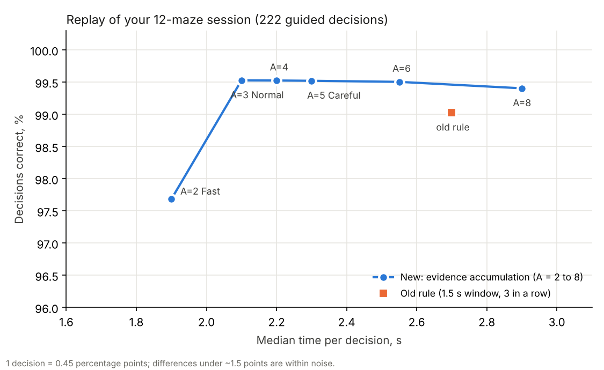

# Results

Everything here is from me, using three dry electrodes, over three days in November 2026. So it shows
what this setup can do for one person, not how it would work for everyone. I've put the sample sizes
in everywhere so you can judge for yourself.

## Early flicker tests

Before the maze I ran two simpler tests to make sure I could see an SSVEP at all.

| Test | Result |
|---|---|
| 2 frequencies (12 vs 15 Hz), one big square | 20/20 correct at every window from 1 s to 4.5 s |
| 4 targets at once (9, 11, 13, 15 Hz), O1 + Oz only | 38/40 at 1 s, 40/40 from 2 s. Both errors were 15 Hz read as 9 Hz |

The 9 Hz target was getting confused with alpha, so I moved all four frequencies above the alpha band
(11 to 17 Hz).

## First maze version

12 guided mazes (following the red box): 217/222 correct (97.7%), a median of 2.8 s per decision,
and about 39 bits/min. 4 of the 5 errors were false "left" moves (17 Hz, my weakest button), and they
were all in the first 4 mazes.

## Finding a faster decision rule

I replayed my recorded sessions offline through the same pipeline the game uses live. It reproduced
the live CCA scores exactly, so I could compare about 2,700 different settings across four types of
decision rule on real data. These are the results on the 12-maze session:

| Rule (12-maze session, 222 decisions) | Median time per decision | Accuracy |
|---|---|---|
| Original (3 windows in a row) | 2.70 s | 99.0% |
| Evidence accumulation, margin 2 | 1.90 s | 97.7% |
| Evidence accumulation, margin 3 | 2.10 s | 99.5% |
| Evidence accumulation, margin 5 | 2.30 s | 99.5% |

There are some catches with this. Each recorded stretch ends where the original rule made its
decision, so I can't fully test rules that are slower than the original. To check I wasn't just
fitting to that one session, I also ran it on the 4-target session (fixed 4 s trials, so it isn't
biased by the old rule), and it agreed: still 100% accurate, and decisions about 0.35 s faster.
Filter-bank CCA was worse than plain CCA at every window length (79% vs 88% at 1.5 s), so I dropped
it.

## Live sessions with the current rule

| Session | Setting | Guided | Free play | Median per decision |
|---|---|---|---|---|
| 22 Nov, 16:52 | Normal, Fast | 110/110 | 182 moves, 0 flagged | 1.8 s (Normal) |
| 22 Nov, 17:31 | Turbo | 108/108 | 98 moves, 1 flagged | 1.6 s |
| 23 Nov | Turbo, Normal | 66/66 | 225 moves, 1 flagged + 1 wall bump | 1.5 to 1.65 s (Turbo), 1.9 s (Normal) |
| **Total** | | **284/284** | **505 moves, 3 unintended** | |

The guided information transfer rate was about 66 bits/min on Normal and 72 on Turbo. Fast only saved
about 0.1 s per move over Normal, because the pause after each move takes up most of the time. In free
play I pressed X right after any move I didn't mean to make. Wrong turns that I chose myself don't
count as errors.

The replay tool gets the same moves I made live on both 22 Nov sessions (292/292 and 206/206). On 23
Nov it matches 281/291, because the tool uses the last calibration of the session and most of those
mazes were played on an earlier one.

## False moves while looking at the maze

This is the hardest part of an SSVEP interface, because you need to look at the maze to plan your
route while four buttons are flickering in the edge of your vision. Over about 4.4 minutes of free
play where I waited more than 3 s between moves, I saw two kinds of false move.

The first is a glance, a short strong burst on one button. That looks almost the same as actually
choosing it, and I don't think it can be filtered out without slowing down every move.

The second is a slow build-up. While I was studying the edge of the maze closest to a button, that
button's score slowly crept up to the threshold. I noticed the false moves happened when I was looking
at the maze edges, so I moved the buttons further away from the maze, but I haven't tested that layout
live yet. Raising the minimum average from 0.40 to 0.45 would also have stopped the one case I caught,
but in replay 32 of 751 real moves (4%) would have come later, so it's an option (`--floor 0.45`)
instead of the default.

## Calibration

| | Cue-to-cue variation (standard deviation of a button's score) |
|---|---|
| Original calibration (4 s cues, no breaks) | 0.063 to 0.092 |
| Current calibration (3 s cues, blink breaks) | 0.034 to 0.038 |

Adding the blink breaks cut the variation roughly in half. Across five calibrations on two days, the
"not looking" level barely moved (standard deviation 0.03 or less). The "looking" level moved more,
about 0.1 standard deviation between sittings. It dropped 0.12 to 0.26 between two sessions 40 minutes
apart on 22 Nov, which I think was a contact change, but within one sitting it was stable: two
calibrations 23 minutes apart without moving the headset were within 0.05. The ranking of the buttons
was the same every time, with up (11 Hz) and right (13 Hz) strongest and down (15 Hz) and left (17 Hz)
weakest.

## Limitations

- It's one person over three days. Other people's SSVEP strength, alpha frequency and electrode
  contact will be different.
- It's only three dry electrodes. More channels, or gel electrodes, would give a stronger and cleaner
  signal.
- Free-play accuracy depends on me reporting my own mistakes with the X key, and on every move either
  going toward the goal or being something I chose.
- The speed it recommends after calibration is tested on the same data it was fitted to, so it's a
  sanity check and not a prediction.
